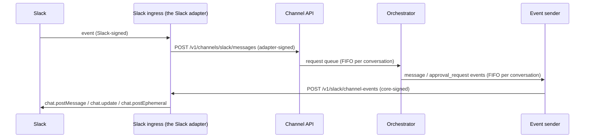
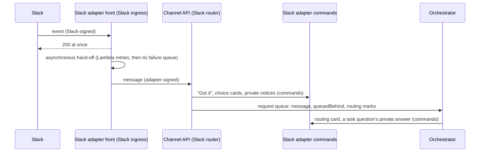

# Implementation Plan: Channel Adapters

**Spec**: [spec.md](./spec.md) · **Issue**: #423

Each phase is one PR to `mainline` and leaves Slack working.

| Phase | Delivers | Spec |
|---|---|---|
| 1 | Neutral conversation, actor and inbound-message model; Slack keys unchanged | FR-001–006 |
| 2 | Neutral bindings; access checks and rate windows read them | FR-010–011 |
| 3 | Adapter registry, channel API, signed events, account linking, step-up | FR-020–033 |
| 4a | Adapter conversations run end to end: broker identity and charging, channel consumer, events, decisions, step-up | FR-035–038 |
| 4b | Orchestrator and commands without Slack; Slack API calls behind one adapter module | FR-040–042 |
| 5a | `agentx adapter` commands; the adapter author's and administrator's guide | FR-051 |
| 5b | Slack as an in-process adapter around a neutral core; ChatGPT commands parsed in the core; the Slack boundary test | FR-041, FR-050, SC-004 |
| 6 | WhatsApp adapter | FR-052 |

## Phase 1: neutral model

| Layer | Change |
|---|---|
| contracts | `conversation.ts`: `ChannelIdSchema`, `ConversationRefSchema`, `ActorRefSchema`, `InboundMessageSchema`; `conversationSubject`, `parseConversationSubject`, `conversationOwnerIssuer`; Slack conversions both ways; `readSlackRequestMessage`. |
| slack-service | `consumer.ts` reads a queued body with `readSlackRequestMessage`, so a Slack `version: 2` message runs exactly as `version: 1`, and another channel's message is discarded. |
| tests | `tests/unit/conversation.test.ts`: Slack subjects and owner issuers equal today's; round trips; refusals. `tests/integration/slack-service.test.ts`: a `version: 2` Slack message is handled, a WhatsApp one is discarded. |
| constitution | 4.1.0 → 5.0.0: Principles I, II, III and VI admit channel adapters (see the spec's Constitution section). `tests/contract/constitution.test.ts` pins the new wording. |

### Decisions

- **Slack keeps its exact keys.** A Slack subject stays three segments and its owner issuer stays
  `slack-thread`, so no DynamoDB row, workspace owner key or S3 session path moves. Other channels get four
  segments, so a subject's channel is known from its shape.
- **IDs are opaque but bounded.** `/` is refused so subjects split unambiguously. The character set covers
  phone numbers (`+`), emails (`@`) and base64url IDs (`=`, `-`, `_`).
- **The queue keeps accepting `version: 1`.** The consumer reads both versions. Slack ingress keeps writing
  `version: 1` until Phase 5, when Slack goes through the channel API: switching earlier gains nothing, and an
  ingress deployed before the consumer would discard Slack messages.
- **`slack.ts` does not delegate to `conversation.ts`.** `conversation.ts` imports the Slack schemas, so
  delegation would be an import cycle. The tests prove the two produce the same subject instead.

### Rollback

Phase 1 changes no stored data and no wire format, so reverting the PR is enough.

## Phase 2: neutral bindings

| Layer | Change |
|---|---|
| contracts | `channel-binding.ts`: `ChannelSpaceRefSchema`, `ChannelBindingSchema`; `channelBindingKey`, `channelBindingPartition`, `channelBindingSortPrefix`, `channelBindingAttributes`, `readChannelBindingItem`, `isChannelBindingKeyOf`; Slack conversions both ways. |
| broker | Every `SLACK_BINDING#` / `CHANNEL#` key now comes from the helpers: `broker.ts` (put, get, delete, developer channel access), `slack-ingress.ts`, `admin-reads.ts`, `admin-change-plans.ts`, `dispatcher.ts`, `developer-routes.ts`, `task-dispatch-access.ts`, `task-person-invite-authority-fence.ts`, `developer/task-project-access.ts`. `getChannelBinding` reads any channel's binding; `getSlackBinding` goes through it. |
| tests | `tests/unit/channel-binding.test.ts`: Slack keys, prefixes and stored attributes equal today's; other channels' keys; refusals. The existing binding contract tests pass unchanged. |

### Decisions

- **Slack rows keep `teamId` and `channelId` and entity type `SLACK_BINDING`;** other channels store `channel`,
  `tenant`, `space` with entity type `CHANNEL_BINDING`. No row moves.
- **A Slack query partition never throws.** An unset `SLACK_TEAM_ID` finds nothing, as today. Another
  channel's tenant must be a valid ID, so `BINDING#<channel>/<tenant>` cannot be forged with `/`.
- **Row integrity checks never throw** (`isChannelBindingKeyOf`); a malformed row is a mismatch, as today.
  Reading a malformed row still throws, as `getSlackBinding` did, so a corrupt row is not "not bound".
- **IAM is unchanged.** The broker and ingress may read only `SLACK_BINDING#*`; `BINDING#*` is granted in
  Phase 3, when the channel API can create the first non-Slack binding.
- **Developer channel access stays Slack-only** (FR-011).

### Rollback

No stored data or wire format changes; revert the PR.

## Phase 3: channel API, events, linking

Off by default: the control-plane parameter `ChannelAdapters` (`enabled` | `disabled`, default `disabled`). Disabled, the
broker serves no adapter routes and the channel API answers 404 to everything. Named environments only, since linking
needs developer sign-in.

| Layer | Change |
|---|---|
| contracts | `channel-adapter.ts`: registration, capabilities, step-up, decision, the nine event types, the queued item; Standard Webhooks `signWebhook` / `verifyWebhook` (checked against the published test vector); link codes, link keys, `maskChannelUserId`. |
| broker: registry | `channel-adapters.ts`: `PUT/GET/DELETE /v1/admin/channels[/{channel}]`, `PUT/DELETE /v1/admin/channels/{channel}/bindings/{tenant}/{space}`. The record is written on a condition, then the signing secret to Secrets Manager, returned once; `?rotate=true` replaces it; delete overwrites it first. |
| broker: linking | `channel-links.ts` (codes and links in the state table), `channel-link-web.ts` (`/review/link/<code>`: sign in, confirm naming channel and masked user ID, CSRF-checked form post), `GET/DELETE /v1/dev/channel-links`, `DELETE /v1/admin/channel-links/...`. Browser sign-in accepts `/review/link/<code>` as a return path. |
| channel API | `channel-ingress.ts`: `POST /v1/channels/{channel}/messages` and `/decisions`. Checks in order: known adapter, readable secret, signature and timestamp, `webhook-id` replay, body schema, path channel = body channel, actor tenant = conversation tenant, space bound to one of the adapter's projects, adapter event ID not seen, actor linked. Accepted items go to a FIFO queue grouped by conversation; a message gets an `ack`. |
| events | `channel-events.ts`: signs and posts each event to the callback URL; resolves the host and refuses non-public addresses; no redirects; text cut to `maxTextLength`; no actions on a stepped-up kind. 408/429/5xx and network errors retry with a growing delay (10 s doubling, at most 15 min), then the dead-letter queue (8 receives) and its alarm. |
| infra | `infra/lib/channel-adapters.ts`: the `ChannelState` table (claims, expired by `expiresAt`), the request FIFO queue and its DLQ, the event queue and its DLQ, both Lambdas, the two routes (no authorizer: the Lambda verifies the signature), the alarm, and least-privilege grants. |

### Decisions

- **Queued, not yet run.** Accepted messages and decisions wait in the request queue; its consumer is Phase 4, when
  the orchestrator stops needing Slack. The flag stays `disabled` until then.
- **Step-up is enforced where a decision is applied (Phase 4).** Only the core knows authoritatively which kind of
  request a decision answers. Phase 3 already strips approve actions from stepped-up kinds before an event leaves
  (`fitEventToAdapter`), and `adapterMayDecide` is the check Phase 4 applies.
- **Claims are released on failure.** A transient failure frees the `webhook-id`, event ID and link-notice claims, so
  the adapter's retry runs. A failed `ack` is logged, not failed, so a queued message is never queued twice.
- **Link codes live in the state table,** expiring on its existing `indexExpiresAt` TTL, because the broker's role
  policy is near IAM's inline size limit: a statement for another table pushed CDK into an overflow managed policy,
  which the deploy role may not create. The broker gets one new statement (create and write adapter secrets, under
  `agentx/<env>/channel-adapter/*`, apart from connector secrets).
- **A link is never replaced silently.** Redeeming a code for an actor already linked fails; the old link must be
  removed first, by its developer or an administrator.
- **New Lambdas need a CDK deploy.** `scripts/test-deploy.ts` lists them, so a code-only TEST deploy moves them once
  they exist; the recorded change-set fixture predates them and is judged against the Lambdas it was recorded with.

### Rollback

Leave or set `ChannelAdapters` to `disabled`. Reverting the PR removes the resources; `ChannelState` holds only
expiring claims, and adapter, binding and link rows in the state table are inert without the code.

## Phase 4a: adapter conversations run

The `ChannelAdapters` parameter still gates everything. Enabled, the orchestrator also reads the channel request queue.

| Layer | Change |
|---|---|
| broker | `channel-conversation.ts`: the service routes accept `x-agentx-conversation` (a four-segment subject) and `x-agentx-actor`, and check the adapter, a binding to one of its projects, the link and an active developer on every call. The identity's `channel` replaces `slack` on the routes a conversation uses: workspace ensure (lazy only), prepare, retry, close, models, connectors, task operations. A thread's charge goes through `threadCharging`: Slack's counters as before, or the linked developer's (`developerCharge`), stored on the thread record with the conversation's marker in the counter's `tasks` set. `failed-preparation.ts` gives an adapter conversation's charge back. |
| orchestrator | `processor.ts` is generic over the thread type; `channel-requests.ts` runs queued items through it, posts replies as `message` events, confirmations as `approval_request` events, and a `done` marker. `consumer.ts` takes the body reader. `main.ts` runs the channel consumer beside the Slack one when both queue URLs are set. |
| confirmations | A decision answers like a click, and only when its digest matches the confirmation's calls; `mayApprove` refuses an `admin` confirmation, by decision or reply, on an adapter that steps `admin` up. Requester IDs accept adapter user IDs. |
| contracts | `message` event; `done` without required text; `approval_request.taskUrl` optional; queued items carry the adapter's `stepUp` (default: every kind). |
| infra | The orchestrator role consumes the request queue and sends to the event queue; the control plane outputs both URLs; the orchestrator stack takes them as optional parameters; `ChannelRequestDeadLetters` alarm, which the health probe reads (the queue itself is not added to the broker's queue reads: one more ARN overflows its policy). |

### Decisions

- **The broker trusts the queue less than the ingress did.** The orchestrator role could name any conversation, so
  every call re-checks the adapter, binding, link and developer. An unlink or removal stops the next call.
- **One person, one allowance.** A linked developer with a Slack identity shares that member's counter (R6), so
  WhatsApp is not a second quota.
- **Records keep their keys.** An adapter conversation's thread record lives at `SLACK_THREAD#<ownerKey>` with entity
  type `CHANNEL_THREAD`, so the readers that skip non-Slack subjects (admin owner, unwaited tasks, stuck cancels) need
  no change; renaming the key would move every Slack row.
- **Replies are queued as they are said.** Each post is a `message` event on the queue before the processor counts it
  said, so a crash loses nothing; `done` is only a marker and a failure to queue it is logged.
- **Text is converted at the edge until 4b.** The core still writes Slack markup; `plainText` drops mentions, shows
  link addresses and undoes escapes. The model is not told to write Slack markup for an adapter turn.
- **No progress notes or Details buttons for adapters yet.** Both need edits and turn records, which adapters do not
  have in 4a.

### Rollback

Leave `ChannelAdapters` disabled, or revert: the orchestrator ignores the channel queues when their parameters are
empty. A revert after adapter conversations were prepared leaves their workspace charges held, since only this code
gives them back; close those workspaces first.

## Phase 4b: the core names no surface

| Layer | Change |
|---|---|
| orchestrator | The classifier prompt, the gate's block reason and the close instruction say "conversation", not "Slack thread". `slackSafe` is `inertText` (entity-escaped, so a summary carries no mention or link anywhere). `ReplySurface` is `"slack"` or `"plain"`; `PLAIN_REPLY_INSTRUCTIONS` asks for plain text and full URLs. |
| orchestrator service | `conversation-format.ts`: `SLACK_FORMAT` and `PLAIN_FORMAT` (escape, reply, split, mention, and the words for "this thread", "mention me again", "reply yes"). The processor, confirmations, workspace messages, the lazy worker and the model commands write through the format; Slack's texts are unchanged. The channel consumer uses `PLAIN_FORMAT`, and Phase 4a's `plainText` converter is gone. `slack-web.ts` holds every Slack Web API call the service makes. |
| broker | `slackWebFetch` in `slack-web.ts` is the one transport; ingress, interactivity, member lookup and the directory call through it, each keeping its own error handling. |

### Decisions

- **Slack's texts are pinned, not rewritten.** Each text is a function of the format, and Slack's constants are that
  function with `SLACK_FORMAT`, so the existing Slack tests prove the texts did not move.
- **Confirmation summaries stay entity-escaped in storage.** They are made inert once, by the gate; Slack shows the
  entities as characters and the plain format unescapes them.
- **Slack-only paths keep Slack words.** Shared tasks, task answers, SWE-bench and eval batches never reach an adapter
  conversation (FR-038), so their texts are unchanged.
- **Schemas stay.** Slack types in the broker and processor go when Slack itself is an adapter (Phase 5).

### Rollback

No stored data or wire format changes; revert the PR.

## Phase 5a: the CLI and the guide

| Layer | Change |
|---|---|
| cli | `admin/channel-adapters.ts` calls the admin routes; `setup/adapter-commands.ts` adds `agentx adapter add|list|remove|bind|unbind|unlink`. `add` prints the signing secret once, or writes it to a mode-600 file with `--secret-file`. |
| docs | `docs/channel-adapters.md`: turning adapters on, registering and binding, linking, and the protocol for adapter authors (IDs, requests, signing, answers, events, retries). |

### Decisions

- **`agentx adapter`, not `agentx channel`.** `channel add` already binds a Slack channel; renaming it would break
  scripts and docs. Spec FR-051 is updated.
- **`--projects a,b` and the global `--project`.** The CLI's root already owns `--project`, so `add` takes a list of
  its own and `bind` reads the global one.
- **Checked before any call.** Step-up kinds, project names, button and length bounds, and IDs are refused locally,
  so a typo never reaches the control plane.

### Rollback

CLI and docs only; revert.

## Phase 5b: Slack as an in-process adapter

Decided 2026-11-10: Slack stays in-process. An HTTP adapter would first need the protocol to carry private messages,
edits, rich buttons, task-workflow actions, user lookups and canvases, and would add a hop and a secret to the
production Slack path.

| Layer | Change |
|---|---|
| contracts | `thread-service.ts`: neutral names for the service routes' messages (`ThreadWorkspaceResult`, `WorkspaceLimit`, …), the same schema objects as the Slack-named ones. `parseChatGptCommand` in `chatgpt.ts`. |
| orchestrator service: core | `processor.ts` exports `processConversationRequest`: `subjectOf` and `format` are required; `postReplyEnd`, `onFinished` and `commands` are the surface's hooks. `consumer.ts` takes its reader and a page-comment hook. The text helpers take a format. `thread-api.ts` is the conversation client. |
| orchestrator service: Slack | `slack-processor.ts` (`processSlackRequest`: Slack's subject and format, the Details button, the turn record, eval batch and SWE-bench commands), `slack-consumer.ts` (Slack request reader, page comments checked against their schema), `slack-thread-api.ts` (SWE-bench and batch routes, the batch watcher's client), `slack-texts.ts` (Slack's texts as constants), and `SLACK_FORMAT` in `slack-format.ts`. |
| channel | The channel consumer calls the core directly, refuses Slack-only commands, and answers the ChatGPT commands with `agentx chatgpt`. |
| tests | `tests/contract/slack-boundary.test.ts`: the conversation core (the orchestrator package, the processor and its texts, the queue runner, the channel modules, the broker's conversation identity) imports no Slack-named contract and no Slack module; elsewhere, files importing Slack-named contracts may not exceed 40. |

### Decisions

- **The Slack queue keeps `version: 1`.** Releases deploy the control plane before the orchestrator, so an ingress
  writing `version: 2` would have Slack messages discarded by an orchestrator older than Phase 1 during the window.
  The consumer reads both; the Slack queue's format is Slack's adapter's own business.
- **Slack's defaults moved, not its behaviour.** `processSlackRequest` passes the same subject, format, Details
  button, record and commands the processor used to apply itself; the Slack tests run unchanged against it.
- **A ratchet, not a rewrite, outside the core.** Developer tasks shared to Slack threads, Slack sign-in, admin views
  and eval batches use Slack as a product feature; they keep their imports, and new code cannot add one.
- **ChatGPT stays private.** An adapter conversation may be a group; the commands get the CLI's names and nothing
  about the connection.

### Rollback

No stored data or wire format changes; revert.

## Phase 7a: the primitives Slack needs

Slack goes through the channel API from Phase 7b (spec FR-070 to FR-074). 7a adds what that needs, behind
capabilities an adapter declares; nothing is sent to an adapter that does not declare it, and nothing uses it yet.

| Layer | Change |
|---|---|
| contracts | Capabilities `ephemeral`, `direct`, `forms`, `documents`, `directory`, `startConversations` (absent means off). `message` events take `key`, `parts`, `actions` (buttons, links, selects, forms) and an `ephemeral` audience; a `direct` event goes to one actor outside any conversation. `ChannelActionSchema` for presses and form submissions. `ChannelCommandSchema` (`start_conversation`, `create_document`, `delete_document`, `space_members`, `user`, `user_by_email`), its results and answers, and `adapterTakesCommand`. Registration takes an optional `commandsUrl`. |
| broker | `channel-commands.ts`: `sendChannelCommand` signs a command with the adapter's secret (the command's ID as `webhook-id`), refuses a kind the adapter does not declare, a private address and redirects, and accepts only an answer signed for that same ID. The channel API takes `POST /v1/channels/{channel}/actions` (with a conversation, for now) and queues them. The event sender drops a private or direct message to an adapter that cannot keep it private, form buttons without `forms`, and actions past the adapter's buttons. |
| orchestrator service | The channel consumer runs an action by its ID through a handler registry; one with no handler is logged and dropped. |
| infra | The actions route. |

### Decisions

- **Forms are declared on the button.** Slack opens a modal only within 3 seconds of a press, which no queue round
  trip meets, so the adapter opens the form itself and posts the submission as one action.
- **Commands answer synchronously, signed both ways.** Starting a conversation, creating a canvas and reading a
  channel's members need their answer before the core can go on; the answer's signature repeats the command's ID, so
  it cannot be replayed onto another command.
- **Private means private.** An ephemeral or direct message to an adapter without that capability is dropped, never
  shown to the whole conversation.
- **Absent capabilities are off.** Records registered before 7a read as they did.

### Rollback

Nothing uses the primitives yet; revert.

## Phase 7b: Slack's conversations through the channel API

Behind `SlackViaChannel` (default `disabled`; named environments only). Disabled, nothing changes. Enabled, an ordinary
Slack conversation request takes the same path as any adapter's:

| Layer | Change |
|---|---|
| contracts | `builtInAdapterRecord` and `builtIn` on a record (never stored); queue items may carry no developer; events may name any channel; `channelEventGroupId`; `usableWebhookSecret` (the deployment's generated secret has no `whsec_` prefix); `TURN_DETAILS_ACTION_ID`. |
| broker | `adapterForChannel`: the built-in adapter for its channel, a registered one only while `ChannelAdapters` is on. The channel API takes the built-in adapter's requests from any bound Slack channel, with no link, no step-up and no ack (Slack ingress says "Got it" itself); the API is reachable when either setting is on. The event sender holds a conversation's later events behind a retried one. `slack-adapter.ts`: the forwarder (Slack ingress → channel API) and the events route (core → Slack: posts, keyed edits, private replies, Slack's confirmation and Details blocks; 429/503 to retry, 422 to drop). Slack ingress and confirmation clicks use the forwarder when the setting is on. Fix: a registered adapter's `commandsUrl` was dropped when read back. |
| orchestrator service | `channelRequestHandler` takes `surfaces` by channel; `slackChannelRequests` runs Slack's items through `processSlackRequest` (Slack's subject, format, identity, turn records and commands) and answers with events. A Slack item with no surface is dropped. |
| infra | `SlackViaChannel` parameter; the adapter's secret `agentx/<env>/channel-adapter/slack`, generated at deploy and readable by Slack ingress; `POST /v1/slack/channel-events` on Slack ingress; built-in adapter settings on the channel API and event sender; the channel API may read Slack bindings; FIFO event queues (replaced: they carry nothing while both settings are off). |

### Still on Slack's own queue with the setting on (Phase 7c)

- Plain top-level requests where the task workflow routes them (Task 21), `workflow:` starts, task-thread replies and
  questions, stop, feedback notes, ChatGPT commands and task page comments.
- Notices the developer task notifier posts, canvases, directory reads and direct messages.

### Known differences with the setting on

- The "starting now" notice after waiting behind earlier requests is not said; the ingress still says how many are
  ahead. The channel API carries no queue count.
- Each reply is one more Lambda call (the event sender, then Slack ingress). The production account's Lambda concurrency
  is 10, which 7d must allow for.
- Production runs the legacy stack, which has no channel API. 7d needs the channel API and its queues there before the
  old path can go.

### Rollback

Set `SlackViaChannel` to `disabled`: new requests go on Slack's own queue again. Replies still queued for Slack are then
dropped (the built-in adapter is gone), so switch it off once the channel queues are empty.

## Phase 7c1: the notifier's posts through the Slack adapter

With `SlackViaChannel` on, nothing in the core calls Slack's Web API for task notices: the developer task notifier and
the session reconciler send signed commands to the Slack adapter, which makes the Slack calls and answers.

| Layer | Change |
|---|---|
| contracts | Commands `post_message`, `direct_message`, `update_message` (FR-076); `create_document` may omit the tenant. Parts are a message's whole rich form; an `actions` part; a link may keep its action ID. The built-in adapter takes `direct` and `documents` and names a commands URL. `slack-blocks.ts`: `slackBlocksOf` (one Slack renderer for events and commands) and `channelMessageOfSlackBlocks`, which reads the notifier's cards into parts that render back to the same blocks. `splitTextAtLines`, neutral. |
| broker | `ChannelCommandFailed`: `refused` (the adapter's code, or a 4xx) or `unanswered` (may have run). `slack-adapter.ts` takes `POST /v1/slack/channel-commands`: posts, direct messages, private messages, edits, Canvases (made, shared and linked in one command, and removed by the adapter if sharing fails), answered signed with the command's ID. `slack-notice-channel.ts`: the notifier's Slack client over those commands; a refusal is Slack's own error code and no answer is a post that may have landed, so the notifier's delivery rules are unchanged. A card that would not render back the same is logged (`slack_notice.blocks_changed`). |
| infra | The commands route; the commands URL in the built-in adapter's settings; the notifier and reconciler get the adapter's settings, its secret and `SLACK_ADAPTER_TEAM_ID`; Slack ingress gets 30 seconds in named environments (a Canvas is three Slack calls). |

### Decisions

- **Commands, not events, for notices.** The notifier keeps a card's timestamp to edit it, a thread's first post's
  timestamp as the task thread, and Slack's answer to decide what to retry. Only an answered command keeps all three.
- **Cards are read from Block Kit at the edge.** The notifier's card builders are unchanged; its client turns their
  blocks into neutral parts, which the adapter renders back to the same blocks. Rewriting the builders neutrally is
  left for later; nothing outside Slack shows them.

### Rollback

Set `SlackViaChannel` to `disabled`: the notifier and reconciler post to Slack themselves again.

## Phase 7c1b: the Slack directory through the Slack adapter

| Layer | Change |
|---|---|
| contracts | `DirectoryUserSchema`; `user` and `user_by_email` answer one; new `space`, `spaces` and `check` commands (FR-077); tenants optional on the directory commands. The built-in adapter takes `directory`. |
| broker | `slackDirectory` takes a `call`: one Web API read made some other way. `slack-directory-channel.ts` makes each read one command and gives the answer back in Slack's shape, so the directory's caches, call budgets and eligibility rules are unchanged. The adapter answers the directory commands from users.info, users.lookupByEmail, conversations.members/info/list and auth.test. `sendChannelCommand` takes the caller's deadline. |
| infra | Developer sign-in gets the adapter's settings and secret. |

The task-person proof Lambda (the owner-approved TEST-only workload) still reads Slack itself; it moves with 7d.

### Rollback

Set `SlackViaChannel` to `disabled`.

## Phase 7c2: Slack's routing in the core

| Layer | Change |
|---|---|
| contracts | `InboundMessage` takes `addressed`, `messageId`, `viaApp` (FR-078). Queue items carry `queuedBehind` and `routing` (`suggest`, `task_question`). `sendSignedChannelCommand` and `ChannelCommandFailed` move here, so the orchestrator can send commands too. `SLACK_CONFIRMATION_ACTION_ID`. |
| broker | Slack ingress is split: the Slack front (signature, parsing) and `createSlackMentionRouter`, everything it decided after parsing, unchanged. `awsSlackRouterDependencies` takes a `SlackRouterTransport`: Slack's own (bot token, Slack's queue) or the channel's (`slack-channel-router.ts`: the adapter's commands, the channel request queue, the person check over the directory). With `SlackViaChannel` on, Slack ingress runs `createSlackAdapterFront`, which hands messages to an asynchronous invoke of itself for the channel API. The adapter records each thread it posts in (`ROVARA_THREAD#`, 90 days, renewed by each post). The channel ingress gives the built-in adapter's messages to its router (`surfaces`); `channel-api-lambda.ts` composes the two. Confirmation presses go as `slack.confirmation` actions. |
| orchestrator service | The Slack surface takes actions (a confirmation press runs as its `yes` or `cancel`), passes `queuedBehind` to the processor, and hands routed items to Slack's own routing and task-question handlers, which post through the adapter (`slack-adapter-client.ts`). |
| infra | The channel API Lambda's entry is `channel-api-lambda.ts`, with 30 seconds, Slack's threads table, the broker, `SHARED_TASK#` reads and the Slack settings. The orchestrator reads the adapter's secret and takes `SlackAdapterCommandsUrl` and `SlackAdapterSecretName` (control-plane outputs, passed by the CLI). |

### Known differences with the setting on

- A plain reply in a thread Rovara posted in before this phase was deployed is read only once Rovara posts there again.
- A hand-off that fails every asynchronous retry is lost, and lands in Slack ingress's hand-off failure queue, where
  the operator is alerted; Slack's own retries no longer apply once Slack has its answer.

### Rollback

Set `SlackViaChannel` to `disabled`: Slack ingress routes again itself.
