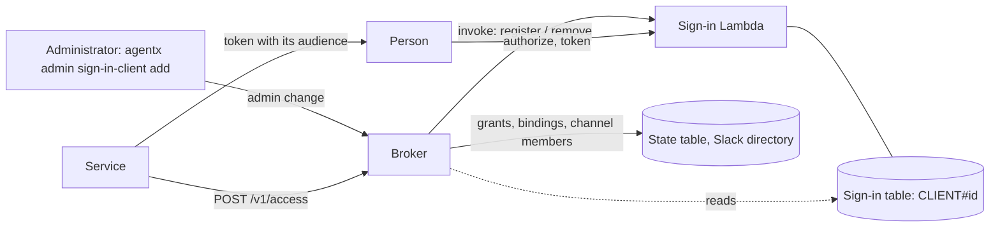

# Implementation Plan: Sign-in for other services

**Spec**: [spec.md](spec.md) · **Issue**: #442

## Where things live

- **The sign-in table owns the registry** (`CLIENT#<id>`): the sign-in Lambda reads it on every authorize, token and
  refresh. Changes go through the sign-in Lambda, as ending sessions does; the broker only reads it.
- **The broker plans and applies the admin changes**, and serves the access check (`POST /v1/access`), since it
  already reads sessions and developers from the sign-in table and owns project access.

## Phases

| Phase | Change |
|---|---|
| 063a | Contracts: `SignInClient`, its registration, the admin change kinds `register_sign_in_client` and `remove_sign_in_client`. Sign-in Lambda: register (new, replace, rotate the secret: only its hash is kept) and remove. Broker: the two planners, applied through the sign-in Lambda; a read route for the list. CLI: `agentx admin sign-in-client add|list|remove`. |
| 063b | Sign-in server: a registered client's authorize (exact redirect or loopback, PKCE), token and refresh (bound to the client; its secret for a confidential client); tokens with its audience and `azp`. A company-login session records `administrator` from `AdminClaim` and `AdminValues`. A test holds that Rovara's API refuses every client audience. |
| 063c | Broker: `POST /v1/access`, by the person's client token, or by developer ID with a confidential client's secret: the live session and developer, `administrator`, and the projects Rovara's own rules give. |

Named environments only: the legacy deployment has no developer sign-in.

## Decisions

- **No new token audience on Rovara.** Rovara keeps accepting only `agentx-developer`; a client token's audience is
  the client's own, so nothing on Rovara's side needs to tell clients apart.
- **Secrets are hashed.** A confidential client's secret is shown once; the table keeps its SHA-256 only.
- **Administrator is a session fact.** Read from the company-login ID token at sign-in, kept on the session, so ending
  the session ends it; a Slack session never has it.
